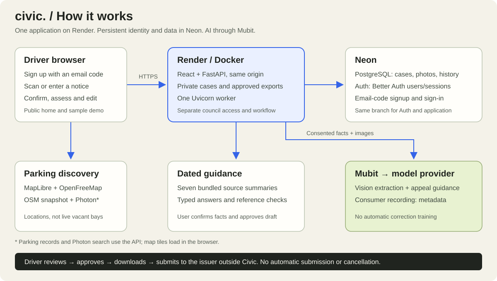

# civic. — Parking, with perspective

**Team: Oz16 (Mubit Hunters in the demo)**

**Understand your parking ticket. Build a clearer appeal. Find parking for your next trip.**

Civic helps drivers in England turn a parking notice and supporting evidence into a reviewed appeal pack. Mubit powers ticket reading and appeal guidance; the driver stays in control of what gets submitted.

**[Hackathon tracks](https://luma.com/nightshift-london), in priority order:**

1. Recurring tasks
2. Own your intelligence layer
3. Fast refresh

**[Open Civic](https://mubit-hunters.onrender.com/) · [Demo video (MP4)](docs/demo/civic-demo.mp4) · [Try the sample ticket](https://mubit-hunters.onrender.com/#demo) · [Explore the London map](https://mubit-hunters.onrender.com/#parking)**

## The walkthrough

1. **Try it first:** process a fictional ticket without an account. The demo calls live Mubit, with a clearly labelled sample walkthrough if unavailable. Reload to start again.
2. **Create your account:** sign up or sign in with a Neon email code. Personal appeals stay private to your account.
3. **Add your notice:** upload a photo or enter the details manually. Check the extracted issuer, reference, dates and amount.
4. **Build your case:** explain what happened, attach evidence and consent to AI processing. Mubit suggests grounds, missing evidence, risks and next steps using dated source summaries.
5. **Prepare your appeal:** edit and approve the draft, download the evidence pack, then submit through the issuer's own website or postal route.
6. **Keep track:** download a calendar reminder and record the issuer's response. Explore nearby parking for your next journey.

## What makes Civic useful

- **One connected flow:** ticket reading, evidence, guidance, drafting and tracking in the same case.
- **Evidence you can check:** linked guidance and explicit uncertainty, with user confirmation before assessment and approval before export.
- **A practical map:** 4,339 mapped London parking locations, search, filters and directions. These are locations, not live vacant bays.
- **An honest demo:** live model/request details are shown; sample results are clearly identified and never counted as customer outcomes.
- **Accessible presentation:** responsive light/dark layouts with a restrained retro style, clear actions and readable case details.

The home page uses sourced industry context: 5.17m London parking PCNs in 2024/25 and 16.9m private-parking keeper lookups in 2025/26. These are different populations, not Civic users or successes. [Figures, definitions and sources](docs/CONSUMER.md#homepage-figures).

## Architecture



| Layer | Role |
|---|---|
| React + Vite | Public home/demo/map, private driver cases and a separate council workspace |
| FastAPI on Render | Authentication, evidence handling, AI orchestration, approved downloads and history |
| Neon PostgreSQL + Neon Auth | Persistent records/photos and managed Better Auth email-code accounts |
| Mubit gateway | Vision extraction and structured appeal guidance through the configured model provider |
| MapLibre, OpenFreeMap, OSM, Photon | Map rendering, bundled parking data and destination search |
| Docker | Reproducible build for Render and optional local use |

One Docker image serves the frontend and API on the same HTTPS origin. Schema migrations run at startup. Live demo inference was verified on **24 October 2026** through Mubit's OpenAI-compatible route using **`gpt-6-luna`**; the model remains configurable. [Architecture and source map](docs/ARCHITECTURE.md) · [Mubit integration](docs/04-mubit-integration.md).

**Mubit usage lookup:** account email **cshivang2002@gmail.com**, model **`gpt-6-luna`**. Reference live demo request in Mubit's **Requests** view: `mreq_01a16fcb1c677e91b653a855a6fa319b` (24 October 2026).

**Committed routing evidence for judges:** [config.py](backend/app/config.py) defines `https://api.mubit.ai/openai/v1` as the OpenAI-route default and `https://api.mubit.ai/anthropic` for Anthropic. [adapters.py](backend/app/ai/adapters.py) sends requests to the configured Mubit base URL, authenticating with `MUBIT_API_KEY` from the environment (`Authorization: Bearer` for OpenAI, `x-api-key` for Anthropic). [render.yaml](render.yaml) sets `AI_PROVIDER=mubit` and declares the key as a runtime secret (`sync: false`). The actual key stays in Render or an ignored local `.env`; it must not be committed.

## Hosting and capacity

The hosted project is **[mubit-hunters.onrender.com](https://mubit-hunters.onrender.com/)**. The existing Render Docker service deploys **`main`**; Neon persists data across deploys. A separate frontend host or evidence bucket is not required for the current small-file implementation.

- **Registered users:** no application account cap; actual capacity depends on the Neon plan, stored evidence and workload. The subscribed plans and maximum simultaneous users have not been verified.
- **Consumer AI:** 200 requests/hour across the app, 20/hour per user. A scan plus assessment uses two calls: a theoretical budget of 100 such journeys/hour before retries, **not a load-tested throughput claim**.
- **Uploads:** eight photos/case, 8 MiB and 24 megapixels per input. Photos are resized and stored in Neon.
- **Deployment:** one Uvicorn worker, with a PostgreSQL pool of up to eight connections. Scale only after measurement and shared-state/job-queue work.

See [capacity, storage examples and scaling](docs/CAPACITY.md) and [deployment, environment settings and troubleshooting](docs/DEPLOYMENT.md).

## Run locally

Requires **Python 3.14** and **Node 22.12+**. From the repository root, this explicitly isolates offline work from any production database/Auth URL in `.env`:

```sh
DATABASE_URL='' NEON_AUTH_BASE_URL='' RENDER='' PCN_ENV=development \
  AI_PROVIDER=stub PCN_DB_PATH=/tmp/civic-local.db \
  PCN_EVIDENCE_DIR=/tmp/civic-local-evidence bash scripts/dev.sh
```

Open **http://127.0.0.1:5173**. Ctrl-C stops both processes. The home, map and sample walkthrough work without accounts. Real driver sign-in requires a separate Neon test branch; live scanning/advice requires Mubit. Use [.env.example](.env.example) and the [local setup guide](docs/DEPLOYMENT.md#local-development). Never point development or tests at the production Neon branch.

Docker is optional locally: after configuring `.env`, run `docker compose up -d --build`, then open http://localhost:8000. Stop it with `docker compose down`; retain the named volume. Full Docker setup is in the deployment guide.

## Checks

```sh
.venv/bin/python -m pytest backend/tests -q
npm test --prefix frontend
npm run build --prefix frontend
```

[CI](.github/workflows/checks.yml) also checks selected workflows against disposable PostgreSQL. Tests cover ownership, consent, provider transport, version conflicts, approved exports, auth, persistence and council workflows. Mocked tests do not prove live email delivery, model quality or trained-adapter improvement. Run checks relevant to the change; documentation-only edits do not need a full rebuild.

## Scope and next steps

Civic supports early challenge preparation for England council parking PCNs and private parking charges, backed by seven dated primary-source summaries. It does not automatically submit appeals, cancel tickets, guarantee success or prove a ticket is genuine. Later/uncertain stages are directed to specialist help. Self-reported cancellations/refunds are not verified wins.

The separate [council workspace](https://mubit-hunters.onrender.com/#workspace) retains officer review, policy checks, insights and a synthetic council exchange contract. CEO photos are optional unless the selected council policy requires them. No live supplier-specific connector is included. Approved officer corrections can be exported; automatic Mubit training/adapter activation is not connected. Consumer recording is metadata-only by default; a separate per-case training opt-in permits full recording. The fictional demo requests full recording too. Mubit decides which calls become kept examples; recording does not prove a trained adapter exists.

Next production work is measured load testing, larger-file storage, reliable background AI jobs, maintained guidance, outcome verification and authorised supplier integrations where required. Billing, multi-council tenancy and live parking availability are not implemented.

**[Documentation index](docs/README.md)** · [Driver flow and limits](docs/CONSUMER.md) · [Privacy and risks](docs/07-compliance-and-risks.md) · [Demo runbook](docs/08-hackathon-plan.md)

## License

Application code: [MIT](LICENSE). The derived parking dataset has separate [OpenStreetMap/ODbL attribution and licensing](docs/PARKING-MAP.md#licensing-and-refresh).

Documentation reviewed against the implementation on **24 October 2026**.
