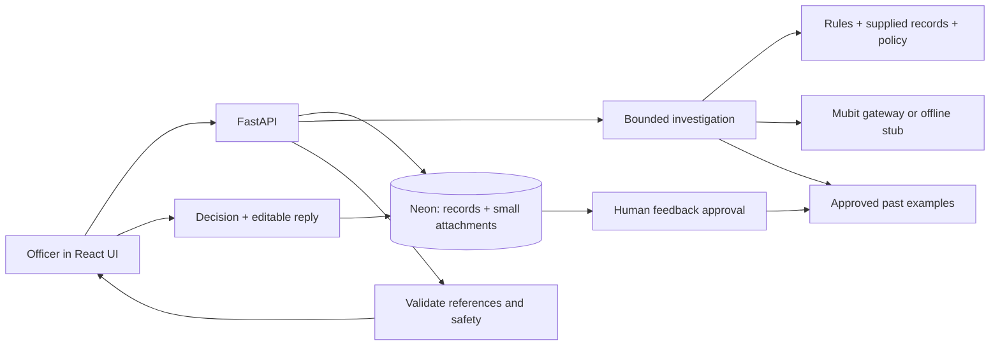

# civic. — Review Copilot

A working full-stack demo for the **parking appeals officer**: the person who reads a driver's challenge, weighs the evidence and decides the outcome.

**Open case → review evidence → get a suggested outcome → choose and edit the reply → save and move on.**

The application developed on `trial-2` is merged into `main`, the deployed branch. The interface uses warm paper, charcoal, electric blue and lime, with restrained retro details. Northgate Borough, its policies and all sample cases are fictional.

## Run locally

Requires Python 3.14 and Node 22.12+.

```sh
bash scripts/dev.sh
```

Open <http://127.0.0.1:5173>, then choose **Explore sample appeals**. No key is required: the default is a clearly labelled, deterministic AI simulation. You can also add a synthetic appeal through the form. Put optional settings in root `.env` using `.env.example`; `backend/.env` remains supported and takes precedence when both exist.

## What is built

- Searchable queue with explicit response dates; evidence and council records beside the copilot.
- A bounded agent that selects read-only checks, plus mandatory deterministic rules.
- Mubit gateway adapter or offline simulation; validated recommendations and visible investigation steps.
- Explicit officer choices, editable response drafts, save-and-next, response downloads and a persistent case history.
- Evidence attachments, JSON import, feedback approval, example retrieval and evaluation tools under Admin.
- Insights calculated from saved decisions; no invented accuracy or savings claims.
- Shared-password demo access, Neon/PostgreSQL persistence on Render, and SQLite for offline use.



## Deploy

```sh
cp .env.example .env
# Set a private PCN_ACCESS_KEY of at least 16 characters in .env.
docker compose up -d --build
```

Open <http://localhost:8000>. React is served by FastAPI. Set `DATABASE_URL` to use Neon; leave it blank for SQLite in the persistent Docker volume. The same Neon URL locally and on Render means both apps share the same cases.

For hosting, the existing Render service runs the Docker image and Neon stores records and small attachments. No separate file bucket is required for this MVP. See [deployment instructions](docs/DEPLOYMENT.md) for the existing service settings, SQLite migration and backup guidance, and [implemented architecture](docs/ARCHITECTURE.md).

## Focused verification

```sh
.venv/bin/python -m pytest backend/tests -q
npm run build --prefix frontend
```

The 40 original tests and four workspace tests are retained. Four focused persistence tests cover shared attachments, review ownership, competing decisions and SQLite migration. SQLite runs 46 tests with two PostgreSQL-only skips; CI also runs the 17 relevant API/workspace/persistence checks against PostgreSQL. There is no extra test framework.

## Scope

This is a **synthetic-data MVP**, not a live council system. The agent reads supplied records and evidence descriptions; it does not fetch council records, interpret uploaded image/PDF contents, send letters or cancel PCNs. Response dates are imported or entered, not calculated as legal advice. The shared password is not SSO or role-based access. Audit rows are append-only in the application, not independently tamper-proof.

Approved examples already inform later reviews. Mubit model training, deployment and measured model improvement remain unverified until exercised with account credentials. The older [design notes](docs/03-architecture.md) describe future scope; `docs/ARCHITECTURE.md` is the implementation reference.

The [revised business case](docs/01-business-case.md) separates evidence, pricing assumptions and competitive risks. The opportunity is to reduce routine review time while preserving officer judgement; a pilot must establish whether it does.
