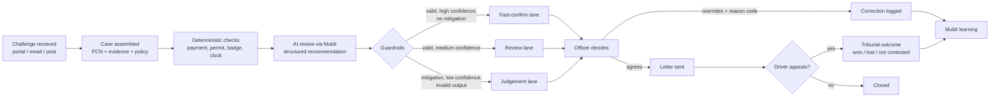

> Original planning notes retained from `main`. Proposals and legal/process assumptions below are not a statement of implemented or verified capability. See [current architecture](ARCHITECTURE.md) and [deployment](DEPLOYMENT.md).

# 2. User process

## Users

| Persona | Role | What they do in the product |
|---------|------|-----------------------------|
| **Priya, Representations Officer** (primary) | Decides challenges | Works the queue, confirms or overrides recommendations, sends letters |
| **Team leader** | QA and allocation | Samples decisions, reviews overrides, reassigns cases |
| **Head of Parking Services** (buyer) | Owns budget and targets | Watches the metrics dashboard and hotspots |
| **Policy owner** | Maintains the discretion policy | Updates policy clauses the AI cites |
| Driver (indirect) | Makes the challenge | Never logs in; receives the officer's letter |
| Highways team (indirect) | Fixes streets | Receives signage/bay hotspot reports |

## Ground rules (non-negotiable)

1. **The AI recommends; the officer decides.** Nothing is sent without an officer's action. (Legal duty to consider each representation.)
2. **Every case is judged on its merits.** No blanket auto-reject rules. (Councils must not fetter discretion.)
3. **Mitigation and vulnerability always go to a human lane**, whatever the confidence.
4. **Every recommendation cites a ground and a policy clause**, or it is not shown.
5. **Every override needs a reason code.** That code is the learning signal.

## End-to-end flow

## Case lifecycle states

| State | Entered when | Owner |
|-------|--------------|-------|
| `RECEIVED` | Challenge arrives | System |
| `ASSEMBLED` | PCN record, evidence and policy attached | System |
| `CHECKED` | Deterministic checks complete | System |
| `RECOMMENDED` | AI output passes guardrails | System |
| `QUEUED` | Placed in a lane, sorted by deadline | System |
| `DECIDED` | Officer accepts or rejects | Officer |
| `LETTER_SENT` | Letter generated and sent | Officer |
| `APPEALED` | Driver appeals to tribunal | System (import) |
| `CLOSED` | Paid, cancelled, or tribunal outcome recorded | System |

## Lanes

| Lane | Entry rule (initial thresholds, assumption) | Officer action | Target time |
|------|---------------------------------------------|----------------|-------------|
| **Fast-confirm** | Deterministic check proves the claim (e.g. valid payment covers the time) **and** AI confidence ≥ 0.90 **and** no mitigation | Check evidence panel, confirm | < 1 min |
| **Review** | Valid recommendation, confidence 0.60–0.90, no mitigation | Read summary and evidence, decide | Few minutes |
| **Judgement** | Mitigation or vulnerability flagged, confidence < 0.60, conflicting evidence, invalid output, or procedural-impropriety claim | Full read, decide with care | As needed |

Within every lane the queue is sorted by **days left** on the legal clock (56 days for formal representations), with red under 10 days.

## Officer's day (SOP)

1. **Open queue.** See counts per lane and red-deadline cases first.
2. **Fast-confirm batch.** For each case: evidence panel shows the proof (e.g. "RingGo session 13:58–15:58 covers 14:05"). Confirm, or open if anything looks wrong.
3. **Review lane.** Read the AI summary, the ground claimed, the cited clause and the draft letter. Confirm or override.
4. **Judgement lane.** Read the full challenge and evidence. The AI file is a starting point only.
5. **Override when needed.** Pick a reason code, add a one-line note. The draft letter regenerates for the new outcome.
6. **Send.** Officer sends the letter. Case moves to `LETTER_SENT`.
7. **Flag a hotspot** if a location keeps producing accepted signage or marking challenges.

## Override reason codes

| Code | Meaning |
|------|---------|
| `OVR_EVIDENCE_MISSED` | AI missed or misread evidence (permit, receipt, badge) |
| `OVR_SIGNAGE` | Signs or markings unclear, missing or wrong |
| `OVR_MITIGATION` | Compelling circumstances justify cancelling |
| `OVR_POLICY_MISAPPLIED` | Wrong discretion clause applied |
| `OVR_PROCEDURAL` | Council made a process or legal error |
| `OVR_FACT_ERROR` | Wrong facts (time, place, vehicle) |
| `OVR_TOO_LENIENT` | AI recommended accept; evidence does not support it |
| `OVR_OTHER` | Anything else, note required |

## Team leader routine

- Sample ~5% of Fast-confirm and ~10% of Review decisions weekly (assumption).
- Review all overrides with `OVR_POLICY_MISAPPLIED` or `OVR_TOO_LENIENT`.
- Watch the false-reject rate ([05-metrics.md](05-metrics.md)); pause Fast-confirm for a pattern if it breaches.

## What changes for the officer

| Today | With the copilot |
|-------|------------------|
| Reads every letter from scratch | Reads a summary with the claimed ground pre-identified |
| Opens 3–5 systems for evidence | Sees one evidence panel |
| Writes each letter | Edits a draft built from approved templates |
| Same mistake repeats across officers | Corrections retrain the council's model |
| No view of patterns | Hotspots and tribunal-risk flags |
