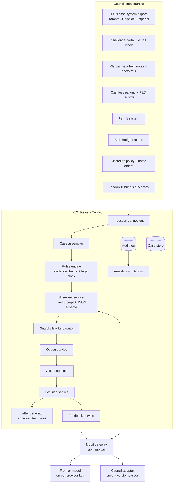
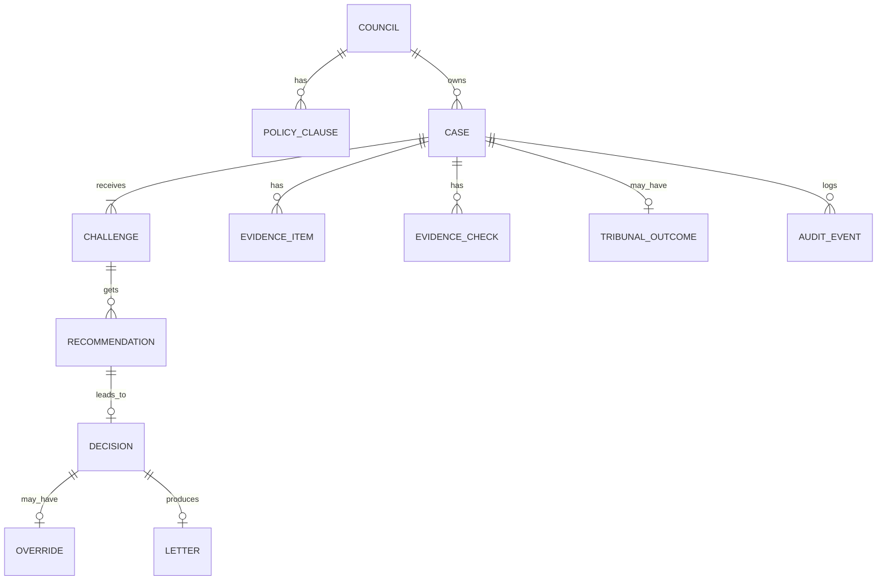

# 3. Architecture

## Design principles

1. **Rules before AI.** Anything a lookup can prove (payment, permit, badge, deadline) is computed deterministically. AI handles reading, matching grounds, weighing policy and drafting. See ADR-002.
2. **One fixed AI task per council.** Same model, instructions, tools, tool choice and output format on every call, so Mubit groups them into one task and trains one adapter per council. See ADR-003.
3. **Structured output only.** The AI returns JSON against [recommendation.schema.json](schemas/recommendation.schema.json): validatable, trainable, auditable. See ADR-004.
4. **Human gate before anything leaves the system.** See ADR-001.
5. **Everything logged.** Every input, recommendation, model version and officer action is an audit event.
6. **Vendor-neutral edges.** Integrations are adapters around case-system exports, not a replacement system. See ADR-009.

## Components



| Component | Responsibility | Hackathon version |
|-----------|----------------|-------------------|
| Ingestion connectors | Pull cases, challenges and evidence from council systems | Synthetic JSON fixtures + generator script |
| Case assembler | Build one normalised **Case Bundle** per challenge | Same |
| Rules engine | Payment/permit/badge checks, observation-time checks, contravention-code rules, legal clock | Python functions over fixtures |
| AI review service | Build the fixed prompt, call Mubit, parse JSON | OpenAI-compatible client pointed at Mubit |
| Guardrails + lane router | Schema check, ground/clause validation, mitigation detection, confidence thresholds | Same |
| Queue service | Lanes sorted by days left | DB query |
| Officer console | Queue, case view, evidence panel, confirm/override, letter preview | Web app |
| Decision service | Record decision, reason code, regenerate letter | API endpoint |
| Letter generator | Fill approved templates with structured fields | Jinja-style templates |
| Feedback service | Turn overrides and tribunal outcomes into Mubit learning signal | See [04-mubit-integration.md](04-mubit-integration.md) |
| Analytics | Metrics + hotspots | Dashboard page |
| Audit log | Append-only event record | DB table |

## Request flow for one case

```mermaid
sequenceDiagram
  participant Src as Council systems
  participant App as Copilot backend
  participant Rules as Rules engine
  participant Mubit as Mubit gateway
  participant LLM as Frontier model / adapter
  participant Off as Officer

  Src->>App: New challenge + PCN ref
  App->>App: Assemble Case Bundle
  App->>Rules: Run evidence checks
  Rules-->>App: Facts (e.g. payment_covers_time = true)
  App->>Mubit: Fixed system prompt (council policy) + case JSON
  Mubit->>LLM: Forward (provider key or adapter)
  LLM-->>Mubit: Recommendation JSON
  Mubit-->>App: Recommendation JSON (call recorded)
  App->>App: Guardrails → lane
  Off->>App: Confirm or override + reason code
  App->>App: Audit event, letter generated
  App->>Mubit: Correction signal (override)
```

## Case Bundle (AI input)

The only thing that varies between calls. Personal data is minimised before it is sent.

```json
{
  "case_id": "C-000123",
  "stage": "formal_representation",
  "days_left": 31,
  "pcn": {
    "contravention_code": "12",
    "contravention_text": "Parked in a residents' or shared use parking place without a valid permit or payment",
    "location_ref": "LOC-ALDER-RD-01",
    "observed_from": "2026-10-02T14:01:00Z",
    "issued_at": "2026-10-02T14:07:00Z"
  },
  "challenge_text": "The sign at the start of Alder Road is faded and I could not read the bay hours...",
  "evidence_facts": {
    "payment_covers_time": false,
    "valid_permit": false,
    "valid_blue_badge": false,
    "warden_photos": 3,
    "warden_note": "No permit or voucher displayed",
    "signage_record": "Sign ALDER-01 reported faded 2026-08-14"
  },
  "prior_outcomes_at_location": {"accepted_signage": 7, "rejected": 2}
}
```

Personal data (names, addresses, full plates) stays in the case store. The AI sees references only (ADR-007).

## Recommendation (AI output)

Defined in [schemas/recommendation.schema.json](schemas/recommendation.schema.json). Key fields: `decision` (`accept` / `reject`), `ground_code`, `policy_clause_id`, `confidence`, `mitigation_flag`, `reasons[]`, `evidence_used[]`, `missing_evidence[]`, `tribunal_risk`, `letter_fields`.

## Guardrails (in order)

1. **Schema validity.** Fail → one retry → Judgement lane.
2. **Ground and clause exist.** `ground_code` in the allowed list; `policy_clause_id` exists in this council's policy. Fail → Judgement lane.
3. **Consistency with facts.** If a deterministic fact proves the claim (e.g. payment covered the time) and the AI says reject → Judgement lane and log as a disagreement.
4. **Mitigation / vulnerability.** `mitigation_flag = true` or keyword hit (illness, bereavement, disability, hospital, emergency) → Judgement lane.
5. **Confidence thresholds.** ≥ 0.90 Fast-confirm (only with a supporting deterministic fact), 0.60–0.90 Review, < 0.60 Judgement.

## Data model



| Entity | Key fields |
|--------|-----------|
| `council` | id, name, mubit_task_label, policy_version |
| `policy_clause` | id, council_id, text, ground_codes, active_from |
| `case` | id, council_id, pcn_ref, contravention_code, location_ref, stage, received_at, legal_deadline, state |
| `challenge` | id, case_id, channel, text, received_at |
| `evidence_item` | id, case_id, type (photo_ref, note, payment, permit, badge, signage), payload |
| `evidence_check` | id, case_id, check_name, result, detail |
| `recommendation` | id, challenge_id, model_id, served_by (provider/adapter), adapter_version, json, confidence, lane, latency_ms, created_at |
| `decision` | id, recommendation_id, officer_id, outcome, agreed (bool), decided_at |
| `override` | id, decision_id, reason_code, note |
| `letter` | id, decision_id, template_id, body, sent_at |
| `tribunal_outcome` | id, case_id, result (allowed / refused / not_contested), date |
| `audit_event` | id, case_id, actor, type, payload, at |

## Audit log

Append-only. Every state change writes an event: `CASE_ASSEMBLED`, `CHECKS_RUN`, `AI_RECOMMENDED` (with model ID, served_by, adapter version), `LANE_ASSIGNED`, `DECIDED`, `OVERRIDDEN`, `LETTER_SENT`, `TRIBUNAL_RECORDED`, `CORRECTION_SENT`. All metrics in [05-metrics.md](05-metrics.md) are computed from it. It also answers the question a tribunal or complaint will ask: who decided, on what evidence, with which model version.

## API (backend)

| Method | Path | Purpose |
|--------|------|---------|
| `POST` | `/cases/import` | Load cases + challenges + evidence |
| `POST` | `/cases/{id}/review` | Run checks + AI review |
| `GET` | `/queue?lane=&council=` | Queue sorted by days left |
| `GET` | `/cases/{id}` | Case view: bundle, checks, recommendation, draft letter |
| `POST` | `/cases/{id}/decision` | `{outcome, agreed, reason_code?, note?}` |
| `POST` | `/cases/{id}/tribunal` | Record tribunal outcome |
| `GET` | `/metrics` | Metrics for the dashboard |
| `GET` | `/hotspots` | Locations with accept clusters |

## Proposed stack (hackathon)

| Layer | Choice | Why |
|-------|--------|-----|
| Backend | Python + FastAPI | Fast to build, OpenAI SDK native |
| Store | SQLite | Zero setup; swap for Postgres later |
| LLM client | OpenAI SDK with `base_url=https://api.mubit.ai/openai/v1` | Mubit's documented one-line integration |
| Frontend | React (Vite) | Queue + case view + dashboard |
| Data | Synthetic generator script | No real personal data (ADR-007) |

## Repo layout (proposed)

```
Mubit-Hunters/
  README.md
  docs/                  # this documentation
  data/
    generator.py         # synthetic councils, cases, evidence, policy
    fixtures/            # generated JSON
  backend/
    app.py               # FastAPI routes
    assembler.py         # Case Bundle
    rules.py             # deterministic checks + legal clock
    reviewer.py          # fixed prompt + Mubit call
    guardrails.py        # validation + lane routing
    letters/             # approved templates
    feedback.py          # corrections to Mubit
    db.py
  frontend/
    src/                 # queue, case view, dashboard
  eval/
    holdout.json         # held-out similar cases for before/after
    run_eval.py
```

## Production path (after the hackathon)

- Connectors for real case-system exports (CSV/SFTP or vendor API), cashless parking and permit systems.
- UK-hosted deployment; Mubit Enterprise in our VPC or self-hosted for data sovereignty.
- SSO for council staff; role-based access (officer, team leader, head of service, policy owner).
- Tribunal outcome import to close the learning loop.
