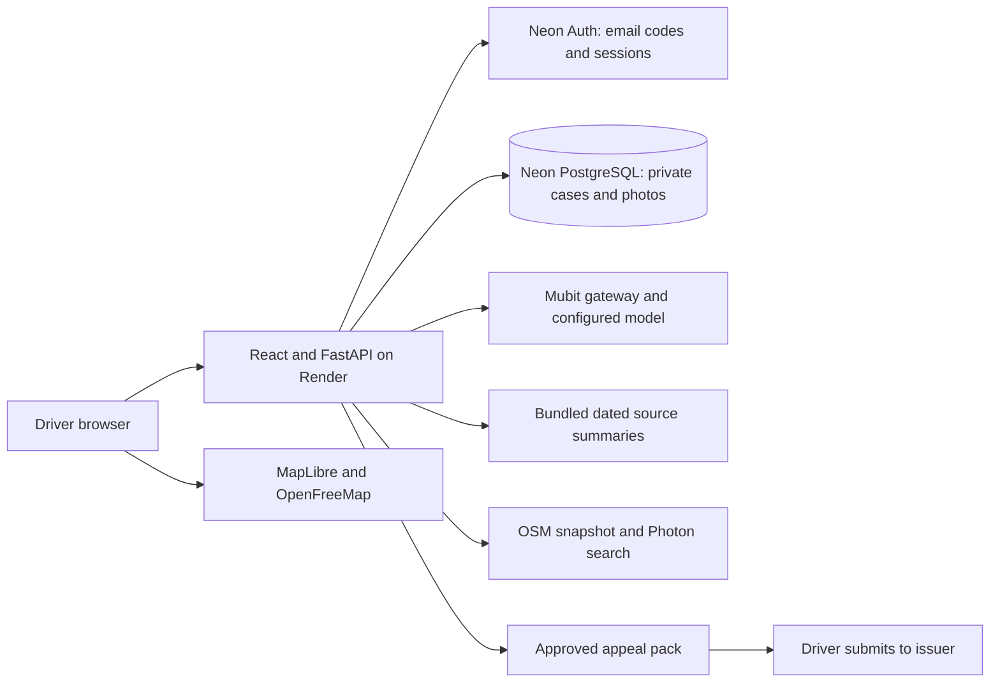

# Architecture guide

Reviewed **24 October 2026**. The original proposed officer-only design has been replaced by the implemented driver-first architecture.

**Canonical reference: [Product architecture](ARCHITECTURE.md).**

| Question | Reference |
|---|---|
| How do cases, images and sessions move through the app? | [Runtime and data boundaries](ARCHITECTURE.md) |
| Where is each feature implemented? | [Source map](ARCHITECTURE.md#responsibilities-and-code) |
| What runs on Render versus Neon versus Docker? | [Deployment](DEPLOYMENT.md) |
| How many users/requests can it handle? | [Capacity](CAPACITY.md) |
| Which model is called and what does Mubit learn? | [Mubit transport](04-mubit-integration.md), [feedback status](MUBIT-FEEDBACK.md) |
| How does council review differ? | [Council workspace](COUNCIL-WORKSPACE.md) |

The [council recommendation schema](schemas/recommendation.schema.json) is a snapshot of `OUTPUT_JSON_SCHEMA` in [ai/prompt.py](../backend/app/ai/prompt.py), not a consumer response contract. Consumer extraction/assessment schemas are the Pydantic classes in [consumer_ai.py](../backend/app/consumer_ai.py). Output validation checks structure and references; it cannot establish that an answer is factually or legally correct.
