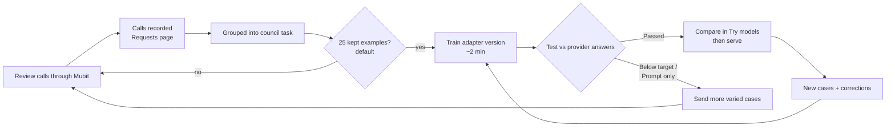

> Original planning notes retained from `main`. Proposals and legal/process assumptions below are not a statement of implemented or verified capability. See [current architecture](ARCHITECTURE.md) and [deployment](DEPLOYMENT.md).

# 4. Mubit integration

## What Mubit does for us, in one line

Mubit sits between our backend and the model provider, records every review call, groups identical-shape calls into a **task**, trains a small **adapter** for that task, tests it against the frontier model's answers, and lets the adapter take over once it passes.

## How we connect

```python
import os
from openai import OpenAI

client = OpenAI(
    base_url="https://api.mubit.ai/openai/v1",   # use the URL the console's Connect page shows
    api_key=os.environ["MUBIT_API_KEY"],
)
```

Model IDs stay the same. Provider calls run on our provider key (or starter credit).

## How our calls become one task

Mubit groups calls with the **same model, instructions, tools, tool choice and output format** into one task. So:

| Part of the call | What we put there | Varies per call? |
|------------------|-------------------|------------------|
| Model | One frontier model ID, fixed per council | No |
| System instructions | `PCN review – <Council name>:` + fixed reviewer instructions + that council's discretion policy | No (per council) |
| Tools | None | No |
| Output format | JSON schema [recommendation.schema.json](schemas/recommendation.schema.json) | No |
| User message | The Case Bundle JSON | **Yes** |

Result: **one task per council**, named from the first words of the instructions. That gives each council its own adapter that learns its own policy, streets and signage (ADR-003).

Rule for the team: **never edit the system prompt casually.** Any change creates a new task and restarts learning. Version it, and change it only on a policy update.

## Lifecycle of the adapter



Statuses to expect on the task: `Collecting examples` → `Reviewing examples` → `Training` → `Testing`. Test results: `Passed`, `Below target`, `Malformed tool calls`, `Prompt only`, `Not tested`.

## How officer corrections reach the model

Mubit's documented test compares adapters with the **provider model's answers**. Our product needs the adapter to learn from **officer overrides**. Three paths, in order of preference:

| Path | How it works | Status |
|------|--------------|--------|
| A. Outcome reporting | Report a verified outcome per call (Mubit's site references `record_outcome()`); override = negative outcome with the corrected decision | **Confirm with Mubit team at office hours** |
| B. Import corrected traces | Write (case input → officer-corrected output) traces to Langfuse/Braintrust/Logfire and use Mubit's "Import past calls" | **Confirm** that imported traces count as kept examples |
| C. Precedent in context (fallback, works today) | Store each override as a council precedent. For new cases, retrieve similar precedents (same contravention code, location, ground) into the **user message**. The frontier model now answers correctly; Mubit records those calls; the adapter learns the corrected behaviour | Needs no special API; task shape unchanged |

We build C regardless (it also improves the frontier model immediately), and add A or B once confirmed.

## Cost curve

| Phase | Who answers | What we pay |
|-------|-------------|-------------|
| Learning | Frontier model | Provider tokens + Mubit $5 per 1,000 runs |
| Adapter passed and serving | Council adapter | Mubit runs; frontier tokens for that task fall away (**confirm billing with Mubit**) |

Illustrative (assumption): a ~3,000-token review on a mid-priced frontier model ≈ 1–1.5¢; a Mubit run = 0.5¢. Learning costs slightly more; serving costs less. A "run" is one request up to 8,000 tokens in and out, so keep Case Bundles compact.

AI cost is the smallest value lever (see [01-business-case.md](01-business-case.md#value-levers-ranked-by-size)); the pitch leads with officer time and fewer wasted rejections.

## Why start with a strong frontier model

The adapter is tested against the frontier model's answers, so it can only be as good as its teacher. A weak starting model gives a weak adapter and a smaller saving (ADR-011). If the open base model already matches, Mubit returns `Prompt only` and no adapter is needed.

## Hackathon limits to plan around

- First training needs ~25 kept examples per task; not every call is kept. Send 60+ varied cases early.
- Daily training limit resets 00:00 UTC; Mubit pauses between trainings. Front-load calls on Friday night.
- Try models: limited daily calls; 3 adapter starts per UTC day; first start takes minutes. Rehearse the comparison before demo day.
- Keep each request under 8,000 tokens.

## Open questions for the Mubit team

1. Which path (A or B) turns an officer correction into training data, and how do we call it?
2. Once an adapter passes, how is production traffic switched to it (model ID, flag, automatic)?
3. Are frontier tokens still charged after switchover for that task?
4. Can one project hold one task per council cleanly, and can we export each adapter?
