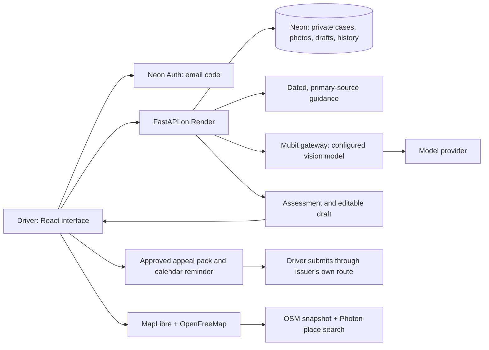

# Civic for drivers

Reviewed against the implementation on **24 October 2026**. **[Hosted app](https://mubit-hunters.onrender.com/) · [Architecture](ARCHITECTURE.md) · [Deployment](DEPLOYMENT.md) · [Capacity](CAPACITY.md)**

The default product is now a personal driver application. The existing council workspace remains at `/#workspace`, with its separate approval and authorisation checks.

## User flow

**Create an account → add a notice → confirm the facts → explain and attach evidence → get Mubit advice → edit and approve a draft → download and submit to the issuer → record the response.**

Public parking discovery is available without an account. It covers the London snapshot described in [PARKING-MAP.md](PARKING-MAP.md), with place search, location-based suggestions, filters, map/list selection and directions. It does not claim live vacancies or guaranteed permission to park.

## Architecture

- The frontend uses a separate consumer API and lazy-loads the map and council workspace.
- `/api/consumer/session/*` uses Neon's existing email OTP flow. New drivers do not need council membership approval. The first-party driver cookie has a separate name and audience and references a live Neon session; every private request rechecks it.
- Every case, image, review, edit and download is owner-scoped. A consumer session cannot access council cases, and a council session alone cannot access consumer cases.
- Migration 5 adds separate `driver_*` tables on startup. Existing council records and the officer feedback migration remain intact. Public totals exclude synthetic council cases.
- Images are limited to eight per case, 8 MiB each and 24 megapixels. JPEG, PNG and WebP are decoded, metadata-stripped, resized and stored privately in Neon. PDF users currently upload page screenshots. This is a deliberate small-file MVP; move high-volume evidence to private object storage later.
- Scan and assessment requests use Mubit, never the offline stub. A missing key or provider error is reported and saved work remains available. Source/evidence references and structured answers are validated. Case versions and database leases prevent stale or concurrent assessments from being accepted.
- Consumer calls request `x-middleware-record: metadata`. They still send the selected facts and photos to Mubit and its configured provider after the user's case-level consent. This is not automatic model training. The officer correction/export workflow is documented separately in [MUBIT-FEEDBACK.md](MUBIT-FEEDBACK.md).

## Deployment and configuration

The existing Render Docker service follows `main`, builds React and serves it with FastAPI. Docker packages the app; Render runs it; Neon stores data and verifies email. No second frontend host or new paid map API key is required.

Keep the existing Render variables: `DATABASE_URL`, `PCN_ACCESS_KEY`, `NEON_AUTH_BASE_URL`, `PCN_PUBLIC_ORIGIN`, `PCN_COOKIE_SECURE=true`, `PCN_EVIDENCE_STORAGE=database`, `AI_PROVIDER=mubit`, `MUBIT_API_KEY`, and the configured Mubit route/model. `DATABASE_URL` and Neon Auth must refer to the same Neon branch. A vision-capable model is required for photos; the route defaults are `gpt-6-luna` for OpenAI compatibility and `claude-haiku-4-5` for Anthropic compatibility. The existing Render configuration was observed using the OpenAI route with `gpt-6-luna`; this release preserves it. A configured key is not proof that a live request succeeds.

In Neon Auth, enable email OTP sign-in **and new user sign-up**, and trust the Render origin. Consumer accounts use Neon email delivery; Resend and the owner notification email remain solely for the council approval flow. A valid `PCN_ACCESS_REQUEST_EMAIL` is currently required by startup validation whenever Neon Auth is configured, even for a driver-focused deployment; Resend itself remains optional.

No production-data copy is required. Startup applies the additive schema migrations; `/api/ready` checks database connectivity. After deployment verify `/api/consumer/public`, then create a fresh driver account, scan a non-sensitive sample notice, confirm its fields and request an assessment. Confirm those requests in Mubit before describing live inference as verified. Local automated tests mock provider responses and do not prove email delivery or model quality.

For local work, use `bash scripts/dev.sh` with a disposable database. **Do not point local tests at the production Neon branch.** The public home/map work without Auth; private accounts require a configured Neon test branch. Real consumer cases never fall back to prewritten answers; the dedicated public sample below offers an explicit labelled fallback. Existing council sample tools remain at `/#workspace`.

## Repeatable sample ticket

Open `/#demo` or choose **Demo ticket** in the navigation. The bundled fictional notice and receipt show a paid parking session that appears to cover the notice time. No signup is needed. The normal Mubit ticket reader extracts the actual image; after the user confirms those fields, the normal adviser receives that extraction, the fixed driver account, both images and the dated source library. Live output shows the returned model and request ID when supplied.

If Mubit is unavailable, errors are visible and the user can explicitly choose the **sample walkthrough**. Those prewritten results are labelled at every step. The server never disguises them as successful inference. The user can edit and approve an example draft and download a watermarked text file; no submission happens. Demo runs never write case records or count as assessed cases or successful outcomes.

Reloading or **Start again** clears browser progress, edits and approval; a fresh live scan makes a new model request. Only the fixed sample is allowed through the public endpoints: no uploads, user prompts, model selection or arbitrary case IDs. Live calls are capped globally at 60/hour and 200/day using the existing database quota mechanism. One demo inference runs at a time per worker. Completed assessment retries reuse that run's result to avoid duplicate billing. Temporary run state lasts 30 minutes in bounded process memory; a restart or different worker may require starting again. The current deployment uses one worker. No new secret or schema migration is needed.

The documents live in `backend/data/consumer-demo/`; regenerate them with `python backend/create_demo_documents.py` when updating the reference sample. Their fixed dates are explicitly presented as a fictional example, not a current ticket deadline. Consumer signup and real cases remain separate.

## Honest product boundaries

### Homepage figures

The homepage presents dated industry context instead of zero-valued product success counters. `frontend/src/MarketingImpact.jsx` keeps each figure, its scope, method and source together. It must never describe industry activity as Civic customers, wins or savings. Live parking-location and guidance-source counts remain visible; the backend's real assessment/outcome counts are unchanged.

Checked 24 October 2026:

- **16.9 million** private-parking DVLA keeper lookups in 2025/26, as reported in [RAC's analysis](https://www.rac.co.uk/drive/news/motoring-news/record-17-million-private-parking-tickets-issued/). Approximately **46,300/day** = rounded annual figure / 365, rounded to the nearest 100. Lookups are a proxy for enforcement activity, not unique motorists or a complete ticket count. Broader UK context, not an England-only total.
- **5,171,275** London parking PCNs in 2024/25, rounded to **5.17m**. [London Councils](https://www.londoncouncils.gov.uk/services/parking-services/enforcement-and-appeals-statistics), Annual Penalty Charge Notice Statistics 2024–25, TOTAL row / Total Parking PCNs column. Includes boroughs and TfL; excludes bus lanes, moving traffic and lorry control. Do not use the 9,462,185 all-contraventions total as a parking-only number.
- **50.5%** of appeals completing the POPLA process ended in cancellation: **54,100 / 107,202**, including **39,522** uncontested appeals and **14,578** allowed appeals. [POPLA 2025 report](https://tag-craft.files.svdcdn.com/production/assets/assets/POPLA/Annual-Reports/POPLA-Report-2025.pdf?dm=1777455861), page 5. This selected second-stage appeal population does not establish the probability of any individual appeal succeeding, nor Civic's success rate. Cancellations are not necessarily refunds.
- **£29.791m** Westminster PCN enforcement revenue, 2024/25, rounded to **£29.8m**. [Council annual report](https://www.westminster.gov.uk/media/document/wcc-parking-annual-report-2024-25), page 23, Enforcement – Penalty Charge Notices, 2024/25 Actual, in £000. Includes parking and traffic PCNs, not just parking tickets. Revenue is not profit; parking surplus spending is described on page 6. This is one borough's reported revenue, not a nationwide/private-sector revenue estimate.
- **£60** is explicitly an illustration: if £60 would otherwise be paid and an unpaid charge is cancelled in full, £60 of payment is avoided. It is not an observed saving, refund, prediction or claim that every charge is £60. Use the actual payable amount including any available discount; losing a discount can increase the cost of an unsuccessful challenge.

These populations and periods are distinct and must not be added. No verified national figure for unique people affected or total money actually collected by private parking firms is asserted. No backend changes or extra environment variables are needed.

### Product scope

- Initial challenge preparation for England council parking PCNs and private parking charges. Rejections, debt collection, court papers and uncertain stages are routed to specialist help without an initial-challenge draft.
- Seven dated primary-source summaries are bundled, including government procedure, England enforcement guidance and conditional private keeper liability. This is a focused starting library, not complete legal knowledge, a live legal search engine or every council's policy. Maintain and revalidate it before expanding coverage.
- The October 2026 private parking code publication must not be treated as commencement. Its parliamentary and transition conditions are preserved in the source summaries.
- Facts, dates and portal links are confirmed by the user. No automatic calculation of legal deadlines or promise that discounts are preserved. Calendar downloads use only a user-confirmed deadline and include an alert two days before it; no reminder email is sent by Civic.
- The driver reviews and approves the text. A ZIP download does not submit an appeal. There is no universal council/private-operator connector or automated cancellation.
- Outcomes and refunds are self-reported. Only independently verified outcomes may enter the verified-success count; this release has no verification workflow, so that count starts at zero. Assessment counts describe saved consumer cases that received an assessment, not wins. Deleting a case removes it from those counts.
- Deleting a case removes active application records and images. Provider records, managed Auth accounts and backups have separate retention. The in-app data page explains these boundaries.

## Focused verification

`backend/tests/test_consumer.py` covers public driver signup without council access, live session revocation, cross-user isolation, consent, provider failure, image validation, assessment/version handling, approved exports, reminders, self-reported outcomes, deletion and the Mubit vision transport contract. The same tests run on SQLite and disposable PostgreSQL in CI. The existing backend suite protects the council flow; frontend tests cover caching and parking helpers. Browser QA used isolated synthetic accounts and AI fixtures. The fixed fictional demo was also verified against live Mubit on the hosted service on 24 October 2026, returning `gpt-6-luna` scan and assessment results. This does not validate all possible tickets, live email delivery or model training.
