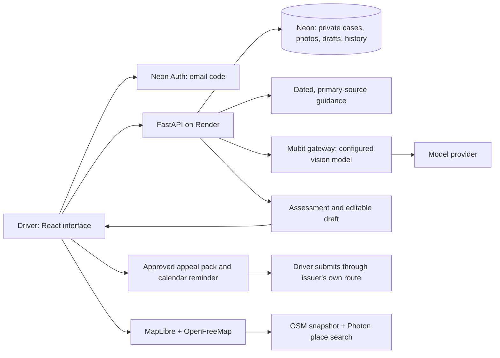

# Civic for drivers

The default product is now a personal driver application. The existing council workspace remains at `/#workspace`, with its separate approval and authorisation checks.

## User flow

**Create an account → add a notice → confirm the facts → explain and attach evidence → get Mubit advice → edit and approve a draft → download and submit to the issuer → record the response.**

Public parking discovery is available without an account. It covers the London snapshot described in [PARKING-MAP.md](PARKING-MAP.md), with place search, location-based suggestions, filters, map/list selection and directions. It does not claim live vacancies or guaranteed permission to park.

## Architecture

- The frontend uses a separate consumer API and lazy-loads the map and council workspace.
- `/api/consumer/session/*` uses Neon's existing email OTP flow. New drivers do not need council membership approval. The first-party driver cookie has a separate name and audience and references a live Neon session; every private request rechecks it.
- Every case, image, review, edit and download is owner-scoped. A consumer session cannot access council cases, and a council session alone cannot access consumer cases.
- Migration 5 adds separate `driver_*` tables on startup. Existing council records and the officer feedback migration remain intact. Public totals exclude synthetic council cases.
- Images are limited to eight per case, 8 MiB each and 24 megapixels. JPEG, PNG and WebP are decoded, metadata-stripped, resized and stored privately in Neon. PDF users currently upload page screenshots. This is a deliberate small-file MVP; move high-volume evidence to private object storage later.
- Scan and assessment requests use Mubit, never the offline stub. A missing key or provider error is reported and saved work remains available. Source/evidence references and structured answers are validated. Case versions and database leases prevent stale or concurrent assessments from being accepted.
- Consumer calls request `x-middleware-record: metadata`. They still send the selected facts and photos to Mubit and its configured provider after the user's case-level consent. This is not automatic model training. The officer correction/export workflow is documented separately in [MUBIT-FEEDBACK.md](MUBIT-FEEDBACK.md).

## Deployment and configuration

The existing Render Docker service follows `main`, builds React and serves it with FastAPI. Docker packages the app; Render runs it; Neon stores data and verifies email. No second frontend host or new paid map API key is required.

Keep the existing Render variables: `DATABASE_URL`, `PCN_ACCESS_KEY`, `NEON_AUTH_BASE_URL`, `PCN_PUBLIC_ORIGIN`, `PCN_COOKIE_SECURE=true`, `PCN_EVIDENCE_STORAGE=database`, `AI_PROVIDER=mubit`, `MUBIT_API_KEY`, and the configured Mubit route/model. `DATABASE_URL` and Neon Auth must refer to the same Neon branch. A vision-capable model is required for photos; the route defaults are `gpt-6-luna` for OpenAI compatibility and `claude-haiku-4-5` for Anthropic compatibility. The existing Render configuration was observed using the OpenAI route with `gpt-6-luna`; this release preserves it. A configured key is not proof that a live request succeeds.

In Neon Auth, enable email OTP sign-in **and new user sign-up**, and trust the Render origin. Consumer accounts use Neon email delivery; Resend and the owner notification email remain solely for the council approval flow. Existing deployments retain their council owner setting because the legacy workspace is still present.

No production-data copy is required. Startup applies the additive schema migrations; `/api/ready` checks database connectivity. After deployment verify `/api/consumer/public`, then create a fresh driver account, scan a non-sensitive sample notice, confirm its fields and request an assessment. Confirm those requests in Mubit before describing live inference as verified. Local automated tests mock provider responses and do not prove email delivery or model quality.

For local work, use `bash scripts/dev.sh` with a disposable database. **Do not point local tests at the production Neon branch.** The public home/map work without Auth; private accounts require a configured Neon test branch. Consumer AI deliberately has no demo fallback. Existing council sample tools remain at `/#workspace`.

## Honest product boundaries

- Initial challenge preparation for England council parking PCNs and private parking charges. Rejections, debt collection, court papers and uncertain stages are routed to specialist help without an initial-challenge draft.
- Seven dated primary-source summaries are bundled, including government procedure, England enforcement guidance and conditional private keeper liability. This is a focused starting library, not complete legal knowledge, a live legal search engine or every council's policy. Maintain and revalidate it before expanding coverage.
- The October 2026 private parking code publication must not be treated as commencement. Its parliamentary and transition conditions are preserved in the source summaries.
- Facts, dates and portal links are confirmed by the user. No automatic calculation of legal deadlines or promise that discounts are preserved. Calendar downloads use only a confirmed notice date.
- The driver reviews and approves the text. A ZIP download does not submit an appeal. There is no universal council/private-operator connector or automated cancellation.
- Outcomes and refunds are self-reported. Only independently verified outcomes may enter the verified-success count; this release has no verification workflow, so that count starts at zero. Assessment counts describe saved consumer cases that received an assessment, not wins. Deleting a case removes it from those counts.
- Deleting a case removes active application records and images. Provider records, managed Auth accounts and backups have separate retention. The in-app data page explains these boundaries.

## Focused verification

`backend/tests/test_consumer.py` covers public driver signup without council access, live session revocation, cross-user isolation, consent, provider failure, image validation, assessment/version handling, approved exports, reminders, self-reported outcomes, deletion and the Mubit vision transport contract. The same tests run on SQLite and disposable PostgreSQL in CI. The existing backend suite protects the council flow; frontend tests cover caching and parking helpers. Browser QA uses only isolated synthetic accounts and AI fixtures, outside the repository.
